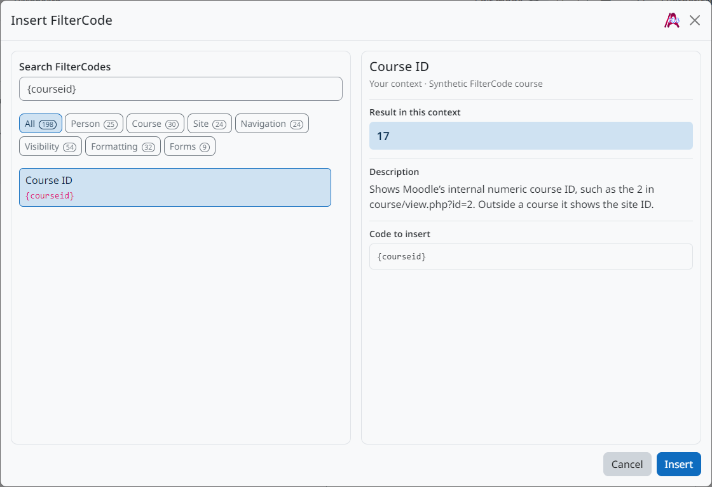

# FilterCode Picker for TinyMCE

Find and insert FilterCodes while you edit Moodle content in TinyMCE. The picker has 198 entries and can show what a tag returns in the current course or activity.

Screenshots

| Browse the catalogue | Preview a formatting tag |
| --- | --- |
|  |  |

## Installation

1. Install [FilterCodes 3.1.0 or later](https://marketplace.moodle.com/plugins/filter_filtercodes/versions). Enable the filter where you want to use the picker.
2. Install the FilterCode Picker ZIP through **Site administration → Plugins → Install plugins**. For a manual installation, place the `filtercodepicker` directory under `lib/editor/tiny/plugins/` in Moodle's web root and run the Moodle upgrade.
3. Open a TinyMCE editor. Use the bracket icon in the toolbar or choose **Insert → Insert FilterCode**.

Supports Moodle 4.5 through 5.3. The picker requires the `tiny/filtercodepicker:use` capability. Editing teachers and managers have it by default in their assigned contexts.

## Using the picker

Search by tag name or browse the categories. Each badge counts the codes in its category. Choose an entry to read its description and see the code before inserting it. If the preview depends on the final page or needs more input, the picker tells you what is missing.

To wrap existing content in a pair of tags, select it in TinyMCE before opening the picker. The selection keeps its formatting. With an empty selection, the picker inserts example text you can replace.

FilterCode Picker is a companion to [Michael Milette's FilterCodes filter](https://github.com/michael-milette/moodle-filter_filtercodes), which processes the inserted tags when Moodle displays the content.

## License

Available free of charge under the terms of the applicable license. See [LICENSE.txt](LICENSE.txt) for the GNU General Public License v3.0 or later.
