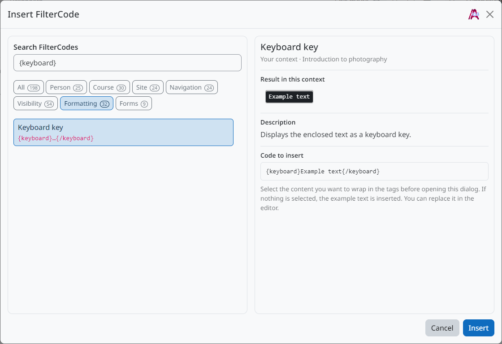

  

# FilterCode Picker for TinyMCE

Find and insert FilterCodes while editing Moodle content in TinyMCE. The picker lists 198 entries and shows a preview when the code can be evaluated in the current course or activity.

Screenshots

| Browse the course codes | Preview formatted text |
| --- | --- |
|  |  |

## Installation

1. Install [FilterCodes 3.1.0 or later](https://marketplace.moodle.com/plugins/filter_filtercodes/versions). Enable the filter where you want to use the picker.
2. Upload the [installation ZIP](https://github.com/108design/moodle-tiny_filtercodepicker/releases) under **Site administration → Plugins → Install plugins**. For a manual installation, place the `filtercodepicker` directory under `lib/editor/tiny/plugins/` in Moodle's web root and run the Moodle upgrade.
3. In TinyMCE, click the bracket icon in the toolbar or choose **Insert → Insert FilterCode**.

## Using the picker

Search by tag name or browse a category. The badges show how many codes each category contains. Select a result to read its description, check the exact code and see a preview where available. Tags that need more input or depend on the final page show an explanation.

To wrap existing text in a pair of tags, select it before opening the picker. The selection keeps its formatting. If you open the picker without a selection, paired tags include example text you can replace.

[Michael Milette's FilterCodes filter](https://github.com/michael-milette/moodle-filter_filtercodes) processes the tags when Moodle displays the content.

## Compatibility and permissions

Supports Moodle 4.5 through 5.3. The picker requires the `tiny/filtercodepicker:use` capability. Editing teachers and managers have it by default in their assigned contexts.

## Support

Use the [issue tracker](https://github.com/108design/moodle-tiny_filtercodepicker/issues) to report a problem. Include your Moodle and FilterCodes versions, the active theme and the steps to reproduce it.

## License

Available free of charge under the terms of the applicable license. See [LICENSE.txt](LICENSE.txt) for the GNU General Public License v3.0 or later.
